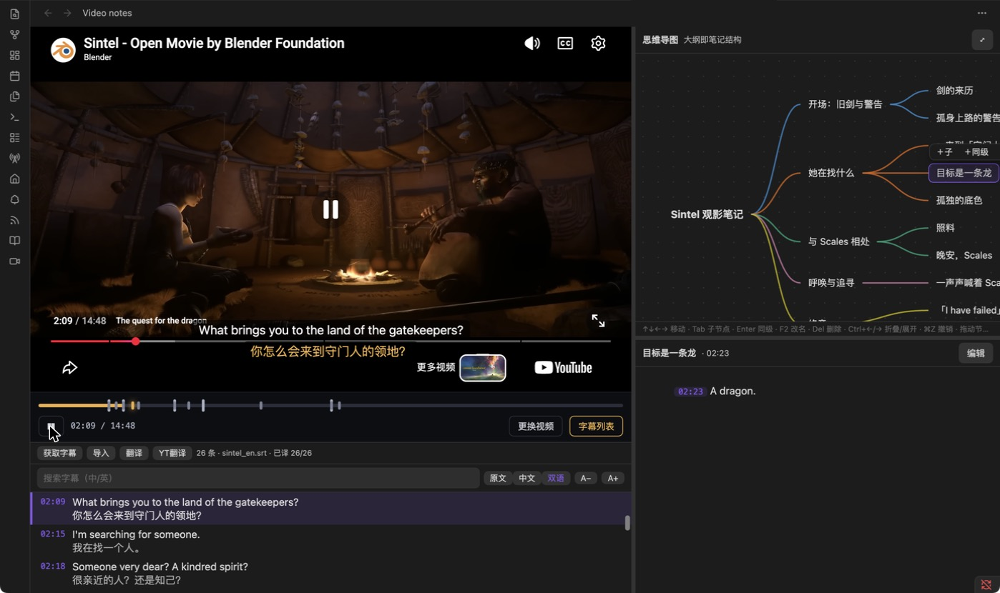
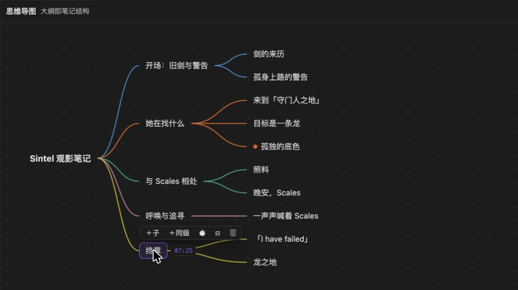
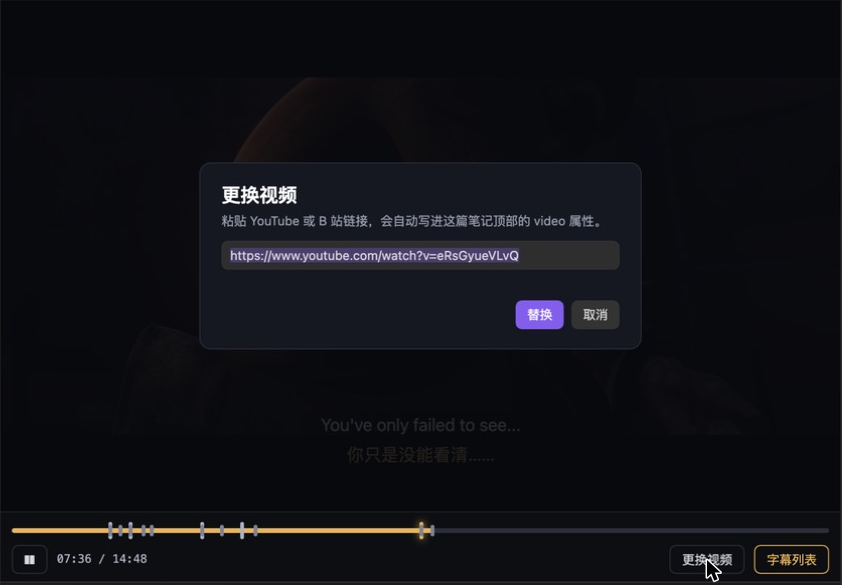

# Video Notes for Obsidian

> Watch a YouTube / Bilibili video on the left. On the right, outline it as a **mind map** and write **Markdown notes** for each node — with subtitles, bilingual captions and one-click jump-to-time.
>
> 左边看视频，右边用**思维导图**搭大纲、给每个节点写 **Markdown 笔记**；带字幕、双语翻译，点一下就跳到对应时间。



*示例视频：Blender 基金会的开源动画短片 [Sintel](https://durian.blender.org/)（CC-BY 3.0）。译文由 AI 接口生成。*

## 它能做什么

**一篇笔记 = 一个视频 + 一份大纲。** 笔记就是普通的 `.md` 文件：标题和列表是导图节点，标题下的正文是这个节点的笔记。卸载插件后笔记依然完整可读。

- **视频**：YouTube、B 站；左右分栏，分隔条可拖动。
- **B 站登录**：B 站视频的控制栏有「B 站登录」按钮，在弹窗里用 B 站官方页面登录（扫码或账号）。登录态保存在 Electron 独立会话里，插件读不到密码和 cookie，只询问「是否已登录」。
- **导图是大纲的入口**：先用导图把结构列出来，再逐个节点填内容。改导图就是改 Markdown 文件，反过来也一样。
- **节点时间戳**：节点文字末尾的 `[mm:ss]` 把大纲和视频位置绑在一起。
  - 点节点只是**选中**（显示它的笔记），不会打断视频；想跳过去，把鼠标移到节点上，点操作栏里的 **▶**。播放时对应节点会亮点提示。
  - 进度条上每个章节（深度 1–2 且带时间的节点）有一个打点，点它会选中节点并跳转。
  - 时间只在选中或悬停时显示；用 ⏱ 按钮或新建节点时自动取当前播放时间。
- **字幕**
  - 自动获取 YouTube 字幕，或导入 `.srt` / `.vtt` / `.json3` 文件；缓存在本地，下次不用重新取。
  - 视频上的**悬浮字幕**可拖动、可调字号，支持 原文 / 中文 / 双语 三种显示。
  - 字幕列表可搜索，点击一行跳转；悬停一行可「摘录」（原 / 中 / 双）到当前节点的笔记，自动带上时间。
- **翻译**
  - **AI 翻译**：填入任意 OpenAI 兼容接口（地址、Key、模型），分批翻译，每批都缓存，可随时停止，失败的批次再点一次只补那些。
  - **YT 翻译**：直接取 YouTube 自带的机器翻译，免费，但质量一般、容易被限流。
- **导图编辑**：键盘优先，支持折叠 / 展开、拖拽改结构（改顺序或换父节点）、撤销 / 重做。
- **节点笔记**：下方显示选中节点自己的内容，用 Obsidian 原生 Markdown 渲染。**点一下正文就能编辑**，点别处（或按 `Esc`）保存；正文里的 `[mm:ss]` 可点击跳转。
- **引导卡片**：笔记没有视频时，视频区直接给一个输入框，粘贴链接就会写进笔记顶部的 `video:` 属性；也可以随时「更换视频」。

| 导图（可全屏） | 没有视频 / 更换视频 |
| --- | --- |
|  |  |

## 安装

插件目前仅支持**桌面端**。

**手动安装（推荐）**

1. 到 [Releases](../../releases) 下载 `main.js`、`manifest.json`、`styles.css`。
2. 放进你的库：`<你的库>/.obsidian/plugins/video-notes/`（文件夹不存在就新建）。
3. 在 设置 → 社区插件 中启用 **Video notes**。

**BRAT**：在 BRAT 里添加仓库 `BBbinlei/obsidian-video-notes`。

**从源码构建**

```bash
npm install
npm run build        # 生成 main.js
```

## 快速开始

1. 新建一篇笔记，顶部写上视频链接：

   ```markdown
   ---
   video: https://www.youtube.com/watch?v=视频ID
   ---
   ```

   或者直接用命令面板里的 **Video notes: New video note…**，输入链接和名称，自动建好。
2. 命令面板运行 **Video notes: Open current note as video note**。
3. 在导图里列大纲（`Tab` 加子节点、`Enter` 加同级），看到重点时按 ⏱ 给节点打点；之后悬停节点点 ▶ 就能回到那一刻。
4. 点字幕列表里的「获取字幕」；需要中文就点「翻译」（先在 设置 → Video notes 里填接口）。

笔记的样子（普通 Markdown）：

```markdown
---
video: https://www.youtube.com/watch?v=eRsGyueVLvQ
---

## 她在找什么 [02:09]

### 目标是一条龙 [02:23]
> [02:23] A dragon.
```

## 快捷键（导图内）

| 按键 | 作用 |
| --- | --- |
| `↑` `↓` | 选同级的上一个 / 下一个节点 |
| `←` / `→` | 选父节点 / 第一个子节点（`→` 在已折叠节点上会展开） |
| `Tab` | 新建子节点（自动带当前播放时间） |
| `Enter` | 新建同级节点 |
| 空格、`F2` 或双击 | 重命名（输入法选字时按回车不会误保存） |
| `Delete` | 删除节点（含子节点） |
| `Ctrl` + `←` / `→` | 折叠 / 展开 |
| `⌘Z` / `⌘⇧Z` | 撤销 / 重做 |
| 拖动节点 | 放到节点上＝变成它的子节点；放到上 / 下边缘＝插到前 / 后 |
| 悬停节点 → ▶ | 跳转到该节点的时间（仅带时间戳的节点有；点击或方向键选中节点不会跳转） |

## 设置

设置 → Video notes：

| 项 | 说明 |
| --- | --- |
| 目标语言 | 翻译成什么语言，默认「简体中文」 |
| YouTube 自动翻译语言码 | 点「YT翻译」时请求的语言，如 `zh-Hans`、`zh-Hant`、`ja` |
| 接口地址 / API Key / 模型 | OpenAI 兼容接口，例如 `https://api.openai.com/v1`。**模型名要和服务商要求的完全一致**（大小写、连字符）。 |

## 数据与隐私

- **笔记**就是你库里的 `.md` 文件；插件不另存一份。
- **字幕与译文缓存**：`.obsidian/plugins/video-notes/cache/`，每个视频一个 JSON。
- **API Key** 以**明文**保存在插件的 `data.json` 里。如果你同步或公开 `.obsidian` 目录，请把它排除。
- **联网请求**只发往：YouTube（播放器与字幕）、B 站视频页（含登录页）、以及**你自己配置的翻译接口**——翻译时会把字幕文字发给该接口。

## 已知限制

- **B 站**：用 Electron `<webview>` 加载 B 站完整视频页并只显示播放器（这样登录态才生效），再读取播放时间；依赖 B 站页面结构，B 站改版后可能需要跟着调整，验证范围有限。B 站字幕暂不支持自动获取，请用「导入」。
- **YouTube 字幕获取**依赖非官方接口，YouTube 可能随时调整；连续请求过多会被**限流（429）**，此时请稍后再试或导入字幕文件。「YT翻译」被限流的概率更高，而且还没有在真实视频上完整验证译文与时间的对齐，欢迎反馈。
- 折叠状态不会保存，重新打开视图后全部展开；折叠记录按节点标题，重命名后该节点会展开。
- 仅桌面端。

## 开发

```bash
npm install
npm run dev       # 监听构建，输出到 dev-vault/.obsidian/plugins/video-notes/
npm test          # 单元测试
npm run deploy    # 构建并复制到 dev-vault
```

`dev-vault/` 是一个自带示例笔记的测试库，可以直接用 Obsidian 打开。

## 致谢

- 导图的解析、编辑、布局核心改编自 [obsidian-mindmap-editor](https://github.com/vulture039/obsidian-mindmap-editor)（vulture039，MIT），见 [NOTICE](NOTICE) 与 [THIRD_PARTY_LICENSES](THIRD_PARTY_LICENSES/)。
- 字幕同屏与双语翻译的想法来自 [qiaomu-clipper](https://github.com/joeseesun/qiaomu-clipper)。
- 截图中的示例视频 *Sintel* © Blender Foundation | [durian.blender.org](https://durian.blender.org/)，CC-BY 3.0。

## 许可证

[MIT](LICENSE)
